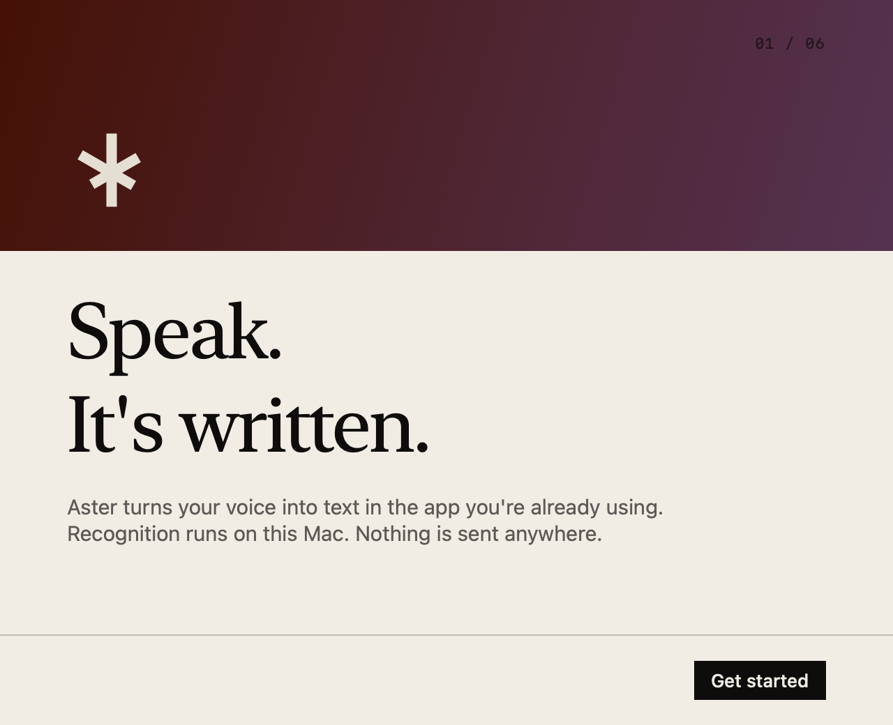

<p align="center">
  <picture>
    <source media="(prefers-color-scheme: dark)" srcset="assets/brand/aster-symbol.svg">
    
  </picture>
</p>

<h1 align="center">Aster</h1>

<p align="center">
  <b>Quiet, on-device voice dictation for macOS.</b><br>
  Hold a shortcut, speak, and text appears at your cursor.<br>
  No account, no cloud, recordings never stored.
</p>

<p align="center">
  <a href="https://github.com/tharunS123/Aster/releases/latest"></a>
  
  
  
</p>

<p align="center">
  <picture>
    <source media="(prefers-color-scheme: dark)" srcset="assets/screenshots/onboarding-1-dark.png">
    
  </picture>
</p>

<p align="center">
  <picture>
    <source media="(prefers-color-scheme: dark)" srcset="assets/screenshots/pill-listening-dark.png">
    
  </picture>
  &nbsp;&nbsp;&rarr;&nbsp;&nbsp;
  <picture>
    <source media="(prefers-color-scheme: dark)" srcset="assets/screenshots/pill-inserted-dark.png">
    
  </picture>
</p>

<p align="center"><sub>Hold ⌥ Space and speak; let go and the text lands at your cursor. Real app screens, rendered offscreen with sample data.</sub></p>

<p align="center">
  <a href="#install">Install</a> ·
  <a href="#what-it-does">Features</a> ·
  <a href="#privacy">Privacy</a> ·
  <a href="#known-limitations">Limitations</a> ·
  <a href="#feedback-and-support">Feedback</a> ·
  <a href="https://aster-landing-nine.vercel.app/">Website</a>
</p>

> **Public beta.** Aster is ad hoc signed and **not notarized** (there is no Apple Developer ID), so macOS needs one extra step the first time you open it. It runs on Apple silicon Macs with macOS 26 or later. It has been tested on the developer's Mac only. Insertion into other apps is reported by the developer and not yet recorded app by app.

This repository holds Aster's downloads, documentation and issue tracker. The source code is kept private; see [LICENSE](LICENSE).

## Install

Requirements: macOS 26 or later on an Apple silicon Mac. Intel Macs are not supported.

1. Download `Aster-<version>.dmg` from the [latest release](https://github.com/tharunS123/Aster/releases/latest), open it, and drag **Aster** to **Applications**.
2. Open Aster. macOS says it can't verify the developer, because the build isn't notarized. Click **Done**.
3. Open **System Settings › Privacy & Security**, scroll to the message about Aster, and click **Open Anyway**.
4. Follow the welcome window: allow the microphone, turn on Aster under Accessibility, and try the shortcut (**⌥ Space**, hold to talk).
5. For the most accurate dictation, open **Settings › Transcription** and click **Download** for Whisper turbo (574 MB, once).

Each release note lists the DMG's SHA-256, so you can check your download with `shasum -a 256 Aster-<version>.dmg`.

**Updating.** Quit Aster, replace it in Applications with the new version, and open it. Each new version is a new app to macOS, so Microphone and Accessibility need granting again.

**Uninstalling.** Quit Aster from the menu bar and delete it from Applications. Your data is in `~/Library/Application Support/Aster`; delete that folder too if you want it gone. Settings › Privacy › Data on this Mac also has **Delete everything**.

### First run and permissions

The welcome window walks through these steps:

1. **Microphone.** Click *Allow microphone*, then *Allow* in the macOS prompt. Nothing is recorded before you do.
2. **Accessibility.** This lets Aster type into other apps. Click *Open Accessibility Settings* and turn on **Aster**. Without it, dictation still works, but the text goes to a recovery panel for you to copy.
3. **Shortcut.** The default is **⌥ Space**, *hold to talk*. You can change it or switch to *toggle* mode.
4. **Try it** in the built-in test field.

Until you download Whisper turbo, and for meetings, Aster uses Apple's speech model, which macOS manages.

**Accessibility switched on but not working?** The permission may belong to an older version. Run these, then open Aster and grant access again:

```bash
tccutil reset Accessibility app.aster.Aster
```

```bash
tccutil reset Microphone app.aster.Aster
```

## What it does

- **Dictate anywhere.** Hold ⌥ Space in any app, speak, let go. In toggle mode, press once to start and once to stop. Esc cancels.
- **Whisper turbo, on this Mac.** Recognition by Whisper large-v3 turbo after a one-time download, or Apple's on-device speech model.
- **You choose how much it changes.** *Cleaned* (the default) removes um, uh and stutters and fixes spacing and capitals, and never rewords. *Verbatim* keeps what you said. *Structured* (beta) lays out spoken lists and email sign-offs.
- **Optional formatting.** Turn on spoken corrections ("Tuesday, actually Thursday" keeps only Thursday), spoken punctuation and math, matching the cursor's case and spacing, and "press enter". Since 0.7.3 they start off, so Aster types what you said.
- **It tells you what happened.** *Inserted* means Aster read the field back and saw the text. *Sent, couldn't confirm* means the app took it but wouldn't let Aster check. If the text didn't land (focus moved, a password field, Accessibility off), it's kept for you to copy or insert again.
- **Snippets, vocabulary and learning.** Turn on Snippets, then say "my email" and get your address. Fix the same word twice and Aster offers to learn it, with Undo.
- **Per-app preferences.** Give an app its own language, output mode, style or line breaks. Chat apps join lines so nothing sends early.
- **For developers.** In apps you mark as Technical text, "payment service dot py" becomes `payment_service.py`, and paths, flags and identifiers stay exact.
- **Compose, Transforms and Command Mode.** Speak a request and get a reply, or select text and ask for an edit. They run on Apple's on-device model or a local model on this Mac.
- **Meeting notes.** A local transcript, your notes, and generated notes that cite the transcript lines they came from. Tick that everyone was told before you start.
- **Notes and Insights.** Quick notes from any app, and daily word counts kept on this Mac (never the text).

## Privacy

- **No network while you dictate**, in meetings, or in Compose, Transforms and Command Mode. On one Mac, a network check on the installed app saw 0 connections and 0 bytes while idle, while dictating and during a meeting.
- **Audio is never written to disk.** It stays in memory while a dictation runs or can be retried, and in meetings at most 60 seconds per source.
- **No account, no telemetry, no update checker.** The download has no cloud AI engines and no server for other apps to read your meetings.
- **Downloads only when you click.** Whisper turbo, its speech detector, the local Compose model and the speaker model come from Hugging Face only when you press Download in Settings. Downloads can be cancelled and say so when you're offline.
- **Logs never contain** what you dictated or the app you dictated into.

### What stays on your Mac

**Settings › Privacy › Data on this Mac** lists every file Aster keeps, with what it holds, its limit, Delete and Show in Finder. The welcome window shows the same list.

| Kept for you | Default | Limit |
| --- | --- | --- |
| Dictation history | On | Newest 500; or 24 hours; or off |
| Vocabulary and learned words | On | Until deleted |
| Snippets, Notes, Transforms | n/a | Until deleted |
| Saved meetings (transcripts and notes, no audio) | On | Until deleted, or 30 days |
| Daily word counts (no text) | On | One row per day |
| App preferences | n/a | Until reset |
| Dictation timings (no text or app names) | On | Newest 2,000 |
| Downloaded models | Only if you click Download | n/a |

| Read while you dictate, then discarded, never saved | Default |
| --- | --- |
| Up to 2,000 characters around the cursor, as recognition hints | On |
| Visible text in the front window, **including web pages** (up to 40 names) | On |
| 16 characters before the cursor, to match its case and spacing | **Off** until you turn on Match the cursor |
| Calendar event titles; participant names in call-app windows | On |
| Your own just-inserted text, for 30 seconds, to learn corrections | On |
| The kind of web page you type in (address discarded; Safari, Chrome, Arc, Edge, Brave) | On |
| Project folder file names, never contents | **Off** until you choose a folder |

Never secure fields, password managers, terminals or apps you exclude. Each source can be turned off in the welcome window or in Settings › Privacy & History.

## Known limitations

- **Beta.** Aster has been tested on the developer's Mac and has had no outside testers yet. Read each release's notes first.
- **Formatting can be wrong.** If you turn them on, corrections, spoken punctuation, math, snippets and "press enter" can write the wrong form, especially after a recognition slip. That is why they start off.
- **"Couldn't confirm" in some apps.** Electron and web apps may say *Sent, couldn't confirm* even when the text landed.
- **One language per dictation.** No automatic language detection, mixed-language dictation or translation.
- **Names and technical terms** can be misrecognized. Vocabulary hints help.
- **Aster can't take back typed text.** Use ⌘Z in that app. *Undo…* on the overlay shows what you actually said.
- **Memory.** Whisper turbo uses about 0.8 GB while loaded and is released after a few idle minutes. The local Compose model is about 1.1 GB on disk.
- **Voice editing** is not available yet: no edit type has passed Aster's quality check.
- **Not supported:** Intel Macs, macOS before 26, and the Mac App Store (App Sandbox blocks cross-app Accessibility).

## Feedback and support

- **Found a bug?** [Open an issue](https://github.com/tharunS123/Aster/issues/new/choose) with your Aster and macOS versions and what the overlay showed. Please don't paste what you dictated or meeting text.
- **Have a question or an idea?** Use [Discussions](https://github.com/tharunS123/Aster/discussions), or a feature request.
- **Security problem?** Report it privately; see [SECURITY.md](SECURITY.md).

See [CONTRIBUTING.md](CONTRIBUTING.md) for how to write a useful report, and the [Code of Conduct](CODE_OF_CONDUCT.md).

## Licence

Aster is free to download and use. Its source code is private and all rights are reserved; see [LICENSE](LICENSE). Aster includes open-source components under their own licences, listed in [THIRD_PARTY_NOTICES.md](THIRD_PARTY_NOTICES.md).
